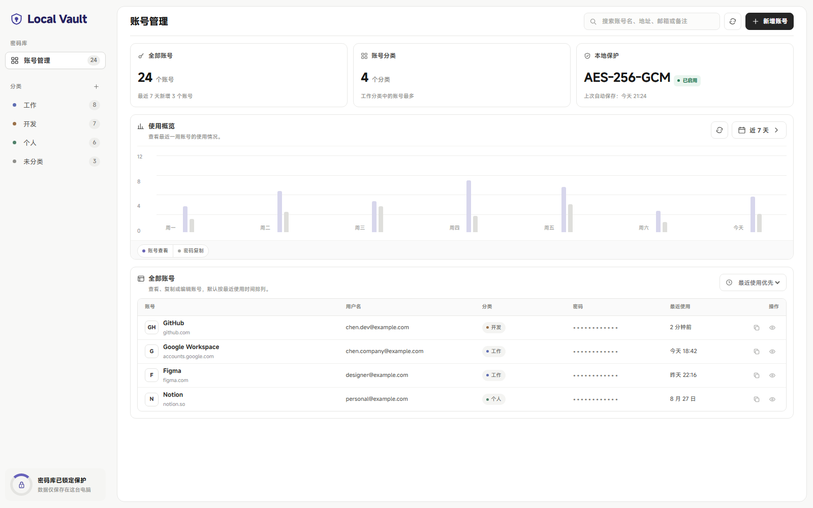

# Local Password Vault

> 轻量、离线的 Windows 本地密码管理器 —— 基于 **Tauri 2 + Rust + Svelte 5**，使用 **AES-256-GCM + Windows DPAPI** 保护本机账号，安装包约 1.9 MB。

[下载 Windows 安装包 (v0.1.0)](https://github.com/C-Q-D/local-password-vault/releases/latest) · [查看发布说明](https://github.com/C-Q-D/local-password-vault/releases/tag/v0.1.0) · [架构设计](docs/architecture/架构设计.md) · [Windows 平台方案](docs/architecture/Windows平台能力方案.md) · [测试与验收](docs/testing/测试与验收.md)



> 界面预览使用模拟账号，不包含真实凭据。

---

## 为什么做这个项目

日常网站账号越来越多，同一站点还常常有工作、个人、测试等多个身份。把密码散落在便签或文档里既不安全也难找；而云端密码管理器通常要求注册账号、订阅服务或托管数据。

**Local Password Vault** 提供一个克制、纯本地的 Windows 桌面方案：打开即可按分类管理、搜索和复制账号，不要求在线登录，也不会把密码库同步到任何远程服务器。

| 常见痛点 | 本项目的处理方式 |
| --- | --- |
| 账号散落各处，临时找不到 | 集中存储在加密本地库，支持按账号名、地址、邮箱和备注即时检索 |
| 同一网站多套身份容易混淆 | 每个账号独立记录，支持按工作、开发、个人等用途自由分类 |
| 不想为了存密码再注册云账号 | 纯本地运行，免注册、无云同步，数据密钥绑定当前 Windows 用户 |
| 频繁查看或复制密码繁琐且易泄露 | 密码默认隐藏且按需读取，支持账号/密码独立复制与 30 秒安全清理 |

---

## 核心功能

- **分类与账号管理**：创建、重命名、安全删除分类（非空分类禁止删除）；新增、编辑、删除账号，支持同一地址保存多条记录。
- **即时搜索与排序**：按账号名、地址、邮箱、备注实时检索（刻意不检索密码内容），支持按分类筛选和最近使用优先排序。
- **安全凭据操作**：账号列表不预取明文密码；支持单独显示/隐藏密码、分别复制账号名与密码，复制密码后自动排除系统剪贴板历史并在 30 秒后条件清理。
- **使用概览与个性化**：按近 7 天、近 1 个月、近半年、近 1 年统计账号查看与密码复制频次；支持界面字体与字号调整，并内置项目架构与数据保护原理说明页。

---

## 下载与安装（Windows 10/11 x64）

1. 前往 [GitHub Releases](https://github.com/C-Q-D/local-password-vault/releases/latest) 下载 `Local.Password.Vault_0.1.0_x64-setup.exe`（约 1.9 MB）。
2. （推荐）在 PowerShell 中核对安装包 SHA-256：
   ```powershell
   Get-FileHash .\Local.Password.Vault_0.1.0_x64-setup.exe -Algorithm SHA256
   ```
   `v0.1.0` 预期值：`15C991611021C67314D067C74D53379277011649346BA16B6A8DDD3F94442263`
3. 运行安装程序，安装后从开始菜单打开 **Local Password Vault**。

> 当前安装包未进行商业代码签名，Windows SmartScreen 可能弹出未知发布者提示。请仅从本仓库 Release 页面下载并核对 SHA-256。

---

## 安全机制与工程亮点

本项目面向高可靠本机存储场景，将安全边界、文件一致性和平台隔离作为核心实现重点：

### 1. 分层解耦架构（无数据库、无重型运行时）

```text
frontend (Svelte 5 + TypeScript + Vite)
  │  仅保留展示与草稿编辑态，不碰文件、不预取明文密码
  ▼  Tauri IPC (薄命令层，仅做参数转换与错误码映射)
src-tauri (commands + 单线程剪贴板清理调度器)
  │
  ├── crates/vault-app              用例编排、已确认快照、单写者串行边界
  ├── crates/vault-core             纯领域模型、校验规则、内存搜索（零平台依赖）
  ├── crates/vault-storage          版本化加密信封、有界解析、原子发布与恢复协议
  └── crates/vault-platform-windows Win32 DPAPI / 文件锁 / 原子替换 / 剪贴板封装
```

- 复用系统 WebView2，不打包完整 Chromium；当前规模下使用加密单文件 + 内存索引，避免引入数据库迁移与额外攻击面。
- Windows 平台 API 完全隔离在 `vault-platform-windows`，通用核心零 OS 依赖，为后续 macOS（Keychain）适配保留清晰端口。

### 2. 版本化加密信封与密钥保护

- **整库认证加密**：密码库（`vault.dat`）与备份（`vault.bak`）采用统一版本化二进制信封，使用 **AES-256-GCM** 同时保护机密性与完整性；每次保存生成全新 12 字节随机 nonce，认证解密通过后才解析 JSON，并做 64 MiB 有界长度检查。
- **用户级密钥隔离**：每份密码库生成独立随机 32 字节数据密钥，经 Windows **DPAPI（`CurrentUser`）** 保护；DPAPI 解包后的敏感内存缓冲在释放前通过 `zeroize` 清零。

### 3. 原子保存、防损坏备份与显式恢复

- **单实例与单写者**：启动读取前先取得数据目录独占进程锁，防止多实例并发写入损坏；应用层所有写操作经由同一互斥边界串行提交。
- **同目录原子替换 + 写后回验**：变更先生成候选快照并校验 → 写入同目录唯一临时文件并 `File::sync_all` → 通过 Win32 `ReplaceFileW` 原子替换主库并保留上一版加密备份 → 重开主库解密校验通过后才切换内存快照。
- **显式恢复、绝不静默覆盖**：针对 `ReplaceFileW` 错误码 `1177` 等异常分支做现场恢复处理；主库损坏且备份有效时，仅在用户明确确认后以只读方式从备份恢复；主备均损坏时进入只读不可编辑状态，绝不新建空库覆盖现场。

### 4. Win32 剪贴板隔离与三重校验清理

- 直接通过 Win32 Clipboard API 在单次 `OpenClipboard` 会话内写入密码文本、应用注册格式 `LocalPasswordVault.ClipboardToken.v1` 以及 `ExcludeClipboardContentFromMonitorProcessing`，阻止密码进入 Windows 剪贴板历史与云剪贴板同步。
- 30 秒后由单工作线程调度器在持有剪贴板锁的前提下，同时校验 **序列号（sequence）+ 应用 token + 剪贴板文本** 三项一致才执行清空，防止误删用户后续复制的其他内容。

---

## 项目结构

```text
local-password-vault/
├── frontend/                        # Svelte 5 + TypeScript 前端界面与 Tauri 调用层
│   └── src/
│       ├── app/                     # 主界面与设置页（字体设置、内置架构说明）
│       ├── lib/                     # Tauri command 封装与本地偏好
│       └── styles/                  # 全局样式
├── src-tauri/                       # Tauri 2 桌面入口、薄命令层与剪贴板清理调度
├── crates/
│   ├── vault-core/                  # 领域模型、业务校验与搜索
│   ├── vault-app/                   # 应用服务、已确认快照与写入边界
│   ├── vault-storage/               # 加密信封、原子写入协调与备份恢复
│   └── vault-platform-windows/      # Windows DPAPI、进程锁、原子文件与剪贴板实现
├── docs/                            # 架构设计、Windows 方案、测试验收与发布运维文档
├── Cargo.toml                       # Rust Workspace 配置（Edition 2024）
└── package.json                     # 前端依赖与构建脚本
```

---

## 本地开发与验证

### 环境要求

- **操作系统**：Windows 10/11 x64
- **Rust**：`1.96.1` 或更高版本
- **Node.js**：`24` 或更高版本，以及 `npm`

### 常用命令

```powershell
# 安装前端依赖
npm install

# 启动本地开发窗口（支持 Vite HMR）
npm run tauri dev

# 前端类型检查与生产构建
npm run check
npm run build

# 运行 Rust 全工作区测试（当前 v0.1.0 包含 109 项单元与集成测试）
cargo test --workspace

# 构建 Windows x64 NSIS 安装包（输出至 target/release/bundle/nsis/）
npm run tauri build
```

---

## 使用边界与已知限制

- **平台范围**：当前版本仅支持 **Windows 10/11 x64**；不包含云同步、导入导出、浏览器自动填充、移动端或 macOS 版本。
- **威胁模型边界**：本地加密不能替代系统安全防护。如果当前 Windows 用户会话已被恶意程序控制，攻击者仍可能读取进程内存或剪贴板。
- **恢复范围**：当前版本不设主密码，数据密钥绑定当前 Windows 用户 DPAPI 环境；单独复制加密文件无法在另一台电脑、重装后的系统或其他 Windows 用户下恢复。
- **离线运行说明**：账号管理核心功能可完全离线使用；界面默认尝试从小米官方 CDN 加载 MiSans 字体，离线时自动回退系统字体，不会上传任何密码库数据。

---

## 相关文档

| 文档 | 内容说明 |
| --- | --- |
| [架构设计](docs/architecture/架构设计.md) | 技术选型与取舍、模块边界、加密信封格式、原子保存与恢复流程 |
| [Windows 平台能力方案](docs/architecture/Windows平台能力方案.md) | DPAPI 边界、`ReplaceFileW` 失败分支处理、Win32 剪贴板所有权与资源释放细节 |
| [测试与验收](docs/testing/测试与验收.md) | v0.1.0 自动测试结果、产品验收标准映射与已知限制 |
| [发布与运维](docs/operations/发布与运维.md) | 可复现构建步骤、安装包校验、备份位置与回滚说明 |
