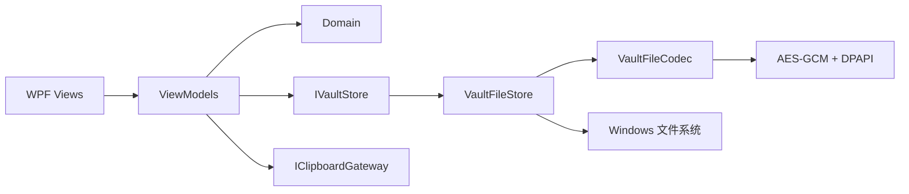
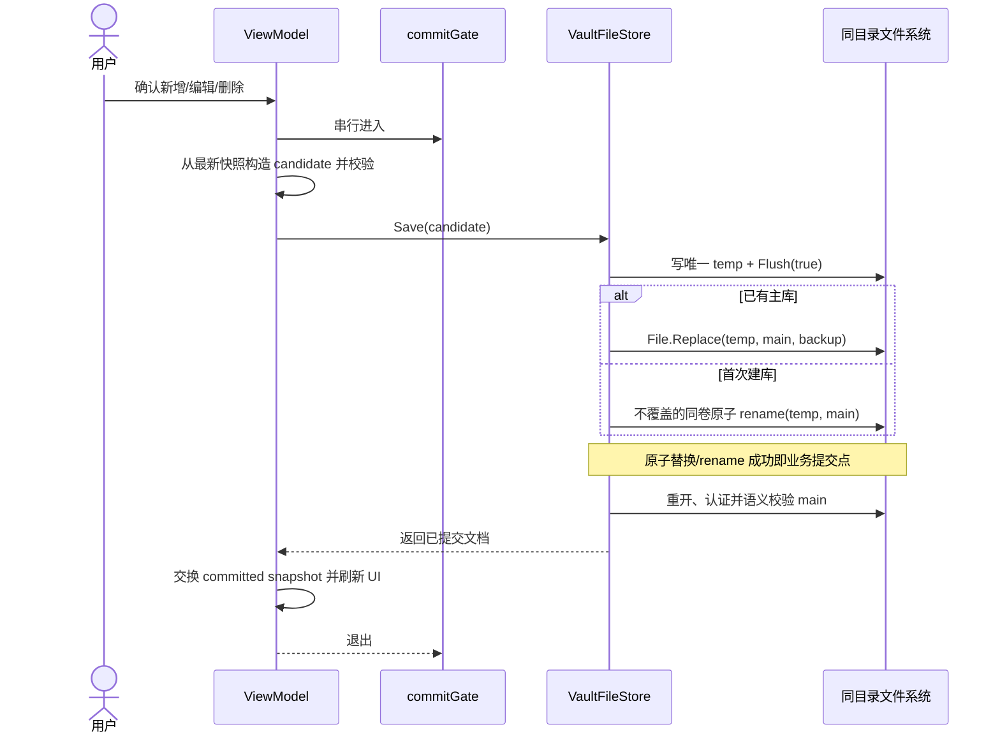
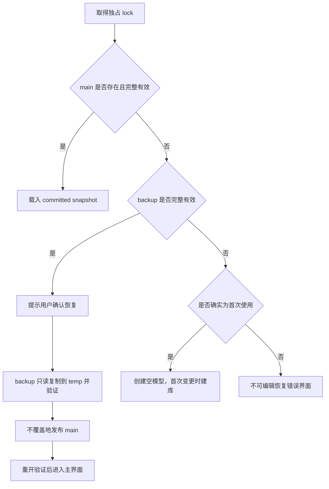

# Local Password Vault 架构设计

## 1. 技术结论

第一版确定使用以下技术栈：

| 领域 | 选型 | 决定 |
|---|---|---|
| 目标平台 | Windows 10/11 x64 | 只支持 Windows，不为跨平台增加成本 |
| 语言与运行时 | C# 14、.NET 10 LTS | 使用当前长期支持版本和 Windows 原生能力 |
| 桌面 UI | WPF、XAML | 单进程，无 WebView，成熟支持数据绑定、中文输入、DPI 和桌面控件 |
| 数据格式 | `System.Text.Json` + 版本化二进制加密信封 | 不引入数据库和 ORM，个人规模下整库读写更简单 |
| 数据加密 | AES-256-GCM | 同时提供机密性和完整性校验 |
| 密钥保护 | Windows DPAPI `CurrentUser` | 无需主密码，密钥只绑定当前 Windows 用户配置 |
| 测试 | xUnit + Windows 发布包集成测试 | 覆盖领域规则、故障保存、恢复和真实重启 |
| 发布 | x64 self-contained 目录包 | 用户无需预装 .NET；不启用 trimming |

这个决定优先优化总体成本，而不是只追求理论最低内存。WPF 是单进程桌面 UI，不需要 Electron/Tauri 的 WebView 进程；相比 Rust 自绘 UI，它显著降低中文输入、键盘操作、剪贴板、DPI 和表单交互的实现风险。第一版不使用 WinUI 3、Electron、Tauri、Flutter、Qt、SQLite、SQLCipher、ORM、通用 DI 框架或通用 MVVM 框架。

## 2. 输入、目标与边界

### 2.1 已接受输入

- 唯一用户是当前 Windows 登录用户。
- App 仅在本机运行，无服务器、网络账号、同步或浏览器扩展。
- 启动后直接进入账号管理主界面，不增加主密码或独立解锁页。
- 持久化内容包含真实账号密码，磁盘不得明文保存，敏感字段不得进入日志。
- 第一版预计不超过 10,000 条账号记录。
- 保存失败不能损坏上一次成功数据，也不能让界面伪装成保存成功。
- 常驻资源必须低，启动、搜索和保存必须快。

### 2.2 明确的安全边界

DPAPI `CurrentUser` 满足“当前 Windows 用户自动解锁”的产品要求，但它不是独立身份验证：

- 防护目标是磁盘静态文件、其他 Windows 用户以及离线复制后的直接读取。
- 不防御已经以同一 Windows 用户权限运行的恶意进程。
- Windows 用户配置或 DPAPI 主密钥丢失后，数据无法仅凭 `vault.dat` 或 `vault.bak` 恢复。
- 第一版的“恢复”只指同一 Windows 用户配置下，从上一份有效加密备份恢复。

跨电脑、系统重装或用户配置丢失后的恢复，需要独立恢复凭据或导出流程，会改变产品范围，不能作为技术实现细节偷偷加入第一版。

## 3. 代码结构与依赖方向

第一版保持一个 WPF 主项目和一个测试项目，不为小应用拆出多个部署单元：

```text
src/LocalPasswordVault/
  App.xaml(.cs)                 组合根、启动和全局错误入口
  Views/                        主窗口、编辑表单和恢复错误界面
  ViewModels/                   UI 状态、命令和独立编辑 Draft
  Domain/                       VaultDocument、Account、Category 和业务规则
  Storage/                      文件格式、加密、原子保存、备份与恢复
  Platform/                     数据目录、独占锁和剪贴板
tests/LocalPasswordVault.Tests/
  Domain/
  Storage/
  ViewModels/
  Integration/
```

依赖只朝内：



- `App.xaml.cs` 直接创建具体依赖，不引入 DI 容器。
- 只在文件存储和剪贴板这两个真实外部边界保留小接口，便于故障注入和条件清除测试。
- 不建立通用 `Repository`、`Manager`、`Factory` 或插件体系。

## 4. 数据模型与业务不变量

### 4.1 持久化模型

```text
VaultDocument
  schemaVersion: int
  revision: long
  categories: Category[]
  accounts: Account[]

Category
  id: Guid
  name: string

Account
  id: Guid
  categoryId: Guid?
  username: string
  password: string
  address: string?
  email: string?
  notes: string?
```

- 账号和分类 ID 一经创建不可变；编辑、删除和分类引用始终按 ID，不按地址、账号名或列表位置定位。
- “全部”和“未分类”是计算得到的系统视图，不持久化为分类。
- 地址、账号名和邮箱均不唯一，保证同站点多账号互不覆盖。

### 4.2 统一校验

候选文档保存前与文档载入后执行同一组校验：

- `schemaVersion` 必须受当前版本支持。
- `revision` 非负且每次成功业务提交递增一次。
- 账号 ID 和分类 ID 分别唯一。
- 每个非空 `categoryId` 都必须指向存在的分类。
- 账号名和密码不能是空白字符串。
- 系统视图不能进入持久化分类集合。
- 删除分类时，同一个候选快照中不得存在引用该分类 ID 的账号。

载入后的语义校验失败按损坏文件处理，不尝试猜测或自动修补。

## 5. 运行与提交模型

### 5.1 稳定数据目录

数据根固定为当前 Windows 用户的：

```text
%LOCALAPPDATA%\LocalPasswordVault\
  vault.dat
  vault.bak
  vault.lock
  vault.tmp.<random>
  vault.corrupt.<timestamp>.<random>
```

实现使用 `Environment.SpecialFolder.LocalApplicationData` 取得规范绝对路径，不依赖当前工作目录、程序目录、快捷方式或安装位置。第一版不支持自定义数据目录。

启动时先创建并验证数据根可写，再读取任何数据。路径、权限或目录类型异常时进入不可编辑错误状态，不创建空库。

### 5.2 单写者所有权

- 读取主库前，以 `FileShare.None` 打开 `vault.lock`，持有句柄直到进程退出。
- 文件锁是跨进程、跨 Windows 会话的写入所有权边界；空锁文件可以长期存在，进程崩溃后由操作系统释放句柄。
- 获取失败时，第二实例显示“应用已在运行或数据目录正被使用”并退出，不读取或写入主库。
- 进程内使用一个 `SemaphoreSlim(1, 1)` 作为 `commitGate`。所有新增、编辑、删除、分类变更、恢复和关闭协调都必须在同一个门内串行执行。
- 搜索、查看和复制是只读操作，不占用 `commitGate`。

### 5.3 Draft 与候选快照

WPF 表单不得双向绑定到已提交的 `Account` 或 `Category`：

1. 新增或编辑表单只绑定独立 `AccountDraft` / `CategoryDraft`。
2. 命令取得 `commitGate` 后，从最新已提交 `VaultDocument` 复制候选快照。
3. 在候选快照上应用变更并执行统一校验。
4. 磁盘提交成功前，已提交模型和列表 UI 保持不变。
5. 提交点前任一步失败，整个候选快照丢弃。

这保证保存失败时，界面不会继续展示尚未落盘的新值。

## 6. 加密文件格式

`vault.dat` 和 `vault.bak` 使用相同的版本化二进制信封：

```text
magic
formatVersion
headerLength
wrappedDataKeyLength
wrappedDataKey          DPAPI CurrentUser
nonce                   12 bytes
authenticationTag       16 bytes
ciphertext              AES-256-GCM(JSON(VaultDocument))
```

- 首次建库生成随机 32 字节数据密钥；持久化时只保存 DPAPI 包装结果。
- 每次保存都用 `RandomNumberGenerator` 生成新的 12 字节 nonce，禁止同一密钥重复 nonce。
- 魔数、格式版本和稳定头字段作为 AES-GCM AAD，防止文件头被无声替换。
- 解密只有在 GCM tag 验证通过后才进入 JSON 解析。
- 普通日志只记录阶段、错误类别和异常类型；不记录账号名、密码、地址、邮箱、备注、JSON、密钥或密文内容。

### 6.1 有界解析

损坏文件在任何分配前必须通过边界检查：

- 文件总大小不超过 64 MiB。
- 固定头、魔数和版本正确。
- DPAPI blob 长度为 1 至 16 KiB。
- nonce 和 tag 长度严格为 12 和 16 字节。
- 所有长度累加使用 checked 算术，分段总和必须等于实际文件长度。
- ciphertext 不超过 64 MiB。

任一检查失败统一进入主库不可用流程，避免畸形文件造成大内存分配或启动崩溃。

## 7. 原子保存与提交点



### 7.1 已有主库

1. 在 `commitGate` 内用最新快照构造并校验 candidate，分配 `revision = current + 1`。
2. 在主库同目录写唯一 temp，完整写入并 `Flush(true)`。
3. 比较当前主文件与载入后保存的认证指纹；路径缺失、reparse point 或内容变化时拒绝覆盖并进入只读冲突状态。
4. 使用 `File.Replace(temp, main, backup)`，让上一版主库成为 `vault.bak`。
5. `File.Replace` 成功即业务提交点。
6. 重开并完整认证、解密和语义校验主库，然后更新认证指纹。

指纹检查只用于发现意外人工或工具修改，不被描述为对同用户恶意进程的安全边界。真正的并发保证来自生命周期文件锁和进程内 `commitGate`。

### 7.2 首次建库

主文件不存在时，temp 完整写入并 `Flush(true)` 后，使用同卷、不覆盖目标的原子 rename 发布。若目标在发布前出现，拒绝覆盖并重新进入主库读取流程。不得退化为直接写主文件。

### 7.3 失败语义

- 提交点前失败：主库、已提交内存快照和列表 UI 不变，向用户显示保存失败。
- 提交点后重验失败：冻结编辑并进入致命错误或恢复流程，不能把磁盘已提交描述为“保存失败”。
- 主库重验成功后 UI 通知失败：从刚重验的文档重建 ViewModel；仍失败则安全退出，不能允许旧 UI 继续保存。

## 8. 启动与恢复



- `main` 存在但无效、`backup` 有效：先把损坏主库原子改名到唯一且不覆盖的 `corrupt` 路径；再从只读 backup 制作 temp、验证并不覆盖地发布主库。
- `main` 缺失、`backup` 有效：跳过损坏文件改名，直接从 backup 制作并发布；若发布前主库出现，停止并重新验证，不覆盖。
- backup 在新主库重开并验证成功前始终只读，恢复失败不得破坏唯一有效副本。
- 主库和备份均无效、缺失或 DPAPI 无法解包：进入不可编辑错误界面，显示非敏感错误类别和数据目录路径，只允许复制/打开目录或退出；不创建空库、不允许保存。
- 只有主库、备份和任何 vault/corrupt 痕迹都不存在时，才能判定为首次使用。

## 9. 剪贴板与内存

- 密码默认隐藏，列表不绑定密码字段。
- 复制密码后保留本次复制值的最短必要引用；30 秒后只有当前剪贴板文本仍等于本 App 写入值时才清空，避免覆盖用户后来复制的内容。
- 剪贴板读取、比较或清除失败不得记录内容。
- App 运行时仍需在当前进程内使用解密后的密码；第一版不声称能够抵御同用户进程内存读取。

## 10. 性能与资源门槛

首个可运行垂直切片必须在 Release x64、Windows 10/11、至少 4 核 CPU、8 GiB RAM、本地 SSD 的代表性环境验证以下门槛。基准使用 10,000 条固定合成账号，代表性平均字段长度为：账号名 32、密码 32、地址 80、邮箱 40、备注 200 个字符，并包含更长备注样本。

| 指标 | 通过门槛 |
|---|---|
| 10,000 条数据冷启动到主界面可交互 | ≤ 1.5 秒 |
| 打开、解密和完整校验 10,000 条数据 | ≤ 700 毫秒 |
| 空闲 30 秒后的 Working Set | ≤ 100 MiB |
| 空闲阶段平均 CPU | ≤ 1% 且无持续后台活动 |
| 10,000 条本地搜索 | p95 ≤ 50 毫秒 |
| 10,000 条整库保存 | p95 ≤ 300 毫秒 |
| x64 self-contained 安装目录 | ≤ 120 MiB |

超过门槛即视为技术实验失败，先定位分配、绑定、序列化或发布热点；无法在当前栈内达到时，重新比较 WinForms 或 Rust 原生 UI。不能用“已经测过”代替“达到门槛”。

## 11. 发布、配置、迁移与回滚

- 开发目标为 `net10.0-windows`；开发机使用 framework-dependent 运行。
- 正式发布使用 x64 self-contained 目录包，让用户无需单独安装 .NET Desktop Runtime。
- WPF 不启用 trimming，避免反射、XAML 和绑定被错误裁剪。
- `PublishReadyToRun` 只有在同一基准证明启动收益值得包体积增长时才启用。
- App 无后台服务、注册表业务配置、网络端口或远程资源；窗口关闭后进程结束。
- 文件格式必须携带版本；当前没有历史数据，因此第一版不做迁移器。格式变更时必须先增加读取兼容或显式迁移，再改变写入版本。
- 应用升级不移动 `%LOCALAPPDATA%` 数据。程序回滚时，如果旧版本不认识更高文件版本，必须只读拒绝，不能覆盖。
- 本机尚未安装 `dotnet` SDK；进入实现前需要安装 .NET 10 SDK，这不改变架构结论。

## 12. 验证策略

### 12.1 自动测试

- 领域：同地址多账号、稳定 ID、必填字段、重复 ID、悬空分类、非空分类删除。
- ViewModel：Draft 隔离、保存失败后 UI/模型不变、提交后通知异常不允许旧快照继续保存。
- 密码学：AES-GCM 往返、篡改拒绝、每次 nonce 不同、DPAPI 当前用户往返。
- 解析：错误魔数、未知版本、长度溢出、超限文件、截断文件。
- 存储：首次建库、已有库原子替换、各提交阶段故障注入、指纹冲突、backup 不变。
- 并发：两个进程争用同一数据根时只有一个持有 lock；进程内快速双提交严格串行且 revision 连续。
- 恢复：主库损坏、主库缺失、有效/无效 backup、恢复各阶段中断、无有效副本时不可编辑且不创建空库。
- 剪贴板：只有内容仍等于本 App 当次写入值时才清除。

### 12.2 发布包闭环

在一次性 Windows 测试环境或隔离临时 Windows 用户中运行最终 Release x64 发布包，只使用合成数据：

1. 保存包含分类、同地址多账号和可选字段的数据。
2. 正常退出并重新启动，逐字段核对。
3. 篡改主文件，验证 App 不覆盖现场并识别有效 backup。
4. 完成一次确认恢复并再次重启核对。
5. 执行性能和资源门槛。

单元测试中的加密往返不能替代这个发布包保存—退出—重启闭环。

## 13. 备选方案与取舍

| 方案 | 未选择原因 |
|---|---|
| WinForms | 可能略省基础 UI 资源，但复杂列表、详情布局、数据绑定和后续视觉维护不如 WPF；保留为性能门槛失败后的第一备选 |
| WinUI 3 | UI 更新，但 Windows App SDK 的部署与生命周期增加当前不需要的复杂度 |
| Electron | Chromium 多进程与包体积直接违背轻量目标 |
| Tauri | 比 Electron 轻，但仍引入 WebView2、前端工具链和跨语言边界；本项目不需要跨平台 |
| Rust + 自绘 UI | 有机会得到更低内存和更小包，但中文输入、键盘、可访问性、表单行为和开发成本风险更高 |
| SQLite / SQLCipher | 当前数据规模适合内存搜索和整库原子保存；数据库会增加 native 依赖、迁移和加密配置面 |
| KDBX | 成熟可移植，但通常围绕独立主密码和跨工具交换；与“启动直接进入主界面、第一版无导入导出”不匹配 |

## 14. 设计审查结论

- 系统边界、组件职责和依赖方向已明确。
- 数据身份、业务不变量、文件格式和错误语义已明确。
- 加密、密钥保护、并发写入、原子保存和恢复路径已完成三轮风险质疑，最终结果为 `PASS`。
- 性能与资源要求已有可失败门槛；首个实现切片必须实测。
- 当前没有会推翻技术栈的未决问题。

下一阶段只需按用户可感知的端到端价值拆分开发切片；本文件不授权直接开始编码。

## 15. 官方依据

- [WPF 桌面指南](https://learn.microsoft.com/en-us/dotnet/desktop/)
- [.NET 10 支持周期](https://learn.microsoft.com/en-us/dotnet/core/releases-and-support)
- [ProtectedData / Windows DPAPI](https://learn.microsoft.com/en-us/dotnet/api/system.security.cryptography.protecteddata)
- [DataProtectionScope.CurrentUser](https://learn.microsoft.com/en-us/dotnet/api/system.security.cryptography.dataprotectionscope)
- [AesGcm](https://learn.microsoft.com/en-us/dotnet/api/system.security.cryptography.aesgcm)
